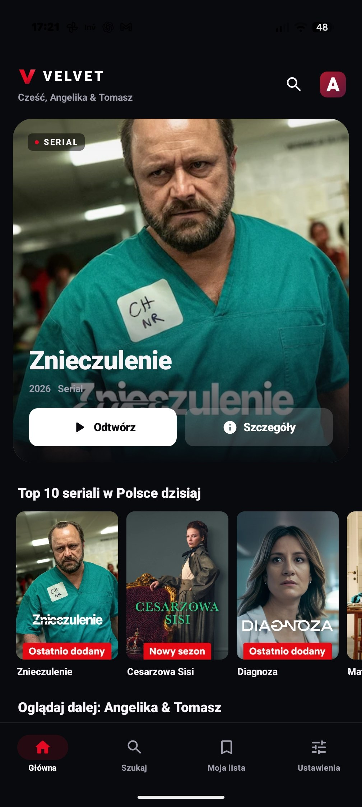
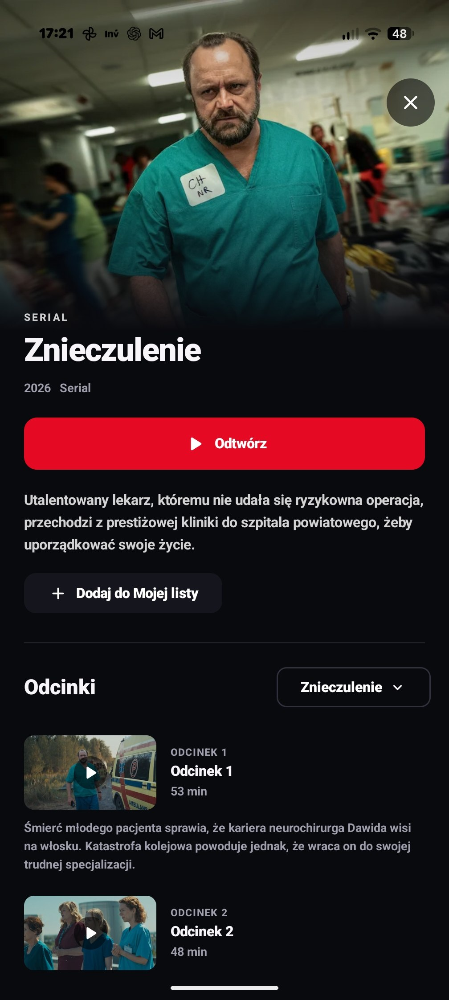

# Velvet

**A functional, open-source Netflix client for Android — with real Netflix sign-in, catalog browsing, and protected video playback.**

<div align="center" style="width:100%; display:flex; justify-content:space-between;">

[](docs/screenshot1.jpg)
[](docs/screenshot2.jpg)

</div>

Velvet connects to Netflix using your own account and plays Netflix streams through Android Media3 and the device's Widevine implementation. It is a working client, not a frontend mockup, a sample-video player, or an app that substitutes content from other providers.

Real playback was confirmed on **Google Pixel 9 Pro XL, Android 17 / API 37, Widevine L1** with version **0.1.11** on November 13, 2026. Two playback sessions completed authentication, manifest retrieval, license acquisition, DRM key loading, and first-frame rendering. The user also confirmed that playback worked. This establishes working playback on that device; it does not establish support for every Netflix feature, account, or device. See [verification](docs/VERIFICATION.md).

Licensed under [MIT](LICENSE), with credited third-party adaptations and dependencies.

## Features

- Sign in once on Netflix's real website, displayed inside the app. Velvet does not present a second password form.
- Browse the authenticated Netflix catalog and profiles.
- Search, view title details, browse seasons and episodes, and access My List.
- Play protected Netflix video with a native Android player and Widevine.
- Choose available audio and subtitle tracks; the converter supports native IMSC/TTML subtitles.
- Save resume positions locally for each profile and title.
- Export a session diagnostic report covering multiple errors and previous runs, with sensitive values excluded.

The interface is currently primarily in Polish. Repository documentation is in English.

## Requirements

- Your own Netflix account and an active subscription that provides access to the selected content.
- An Android device with functioning Widevine L1 and the native DRM APIs used by the client.
- Android 10 / API 29 or later for native playback. The application itself has minSDK 28.
- A working Android System WebView and an internet connection.

Widevine L1 alone does not guarantee that Netflix will accept a particular device or client. Velvet has no Netflix client certification.

## Install and sign in

Obtain an APK from this repository's releases when available, or [build it yourself](docs/BUILDING.md).

1. Install the APK and open Velvet.
2. Open sign-in, complete authentication on Netflix's website, and select your profile.
3. Confirm the signed-in session in Velvet.
4. Browse to a movie or episode and start playback.

Native playback activation uses a token issued by Netflix from the existing signed-in session. There is no additional Velvet password prompt and no external token-conversion service.

## Current limits

Velvet implements the core viewing flow; it does not claim complete feature parity with Netflix's official app.

| Area | Current status |
| --- | --- |
| Protected playback | Confirmed on the Pixel configuration above; wider device coverage is unverified |
| Audio | H.264 video and AAC audio tracks were loaded in the successful device sessions; other formats need testing |
| Subtitles | Track discovery and IMSC conversion implemented; subtitle rendering was not exercised in the reported sessions |
| Watch progress | Saved locally; Netflix PDS start/stop/progress reporting is not implemented |
| Ads and live streams | Unsupported; corresponding manifest types are rejected |
| Offline downloads | Not implemented |
| Resolution, HDR, surround sound | No general guarantees; the successful log did not record or verify these capabilities |
| Long sessions and renewal | Not established by the short successful trials; an expired native MSL session requires reopening the title |

The service can change its private protocols. A previously working version may need updates. Known behavior and implementation details are documented in [playback](docs/PLAYBACK.md).

## Build

Use JDK 21 and Android SDK 35. The repository includes the Gradle 8.11.1 wrapper with a pinned distribution checksum.

```sh
./gradlew :app:assembleDebug :app:testDebugUnitTest :app:lintDebug
```

The APK is written to `app/build/outputs/apk/debug/app-debug.apk`. Your local build uses your signing key. See [building and signing](docs/BUILDING.md) for setup and installation details.

## Independence, access, and provenance

**Velvet is an independent, unofficial project. It is not affiliated with, sponsored by, endorsed by, or maintained by Netflix.** Netflix and related names are trademarks of their respective owners.

**Velvet does not provide free Netflix access.** It requires your own valid account, subscription, and entitlement to the chosen title. It does not include accounts, videos, private device credentials, content decryption keys, or a replacement CDM, and it does not bypass Netflix's authentication or Widevine protection.

Velvet is implemented in Kotlin. See [provenance](docs/PROVENANCE.md) and [third-party notices](THIRD_PARTY_NOTICES.md) for credited adaptations and dependencies.

## Documentation

- [Architecture](docs/ARCHITECTURE.md)
- [Playback protocol and lifecycle](docs/PLAYBACK.md)
- [Diagnostics and privacy](docs/DIAGNOSTICS.md)
- [Build instructions](docs/BUILDING.md)
- [Verification and device results](docs/VERIFICATION.md)
- [Provenance](docs/PROVENANCE.md)
- [Changelog](CHANGELOG.md)
- [Contributing](CONTRIBUTING.md)
- [Security reporting](SECURITY.md)

